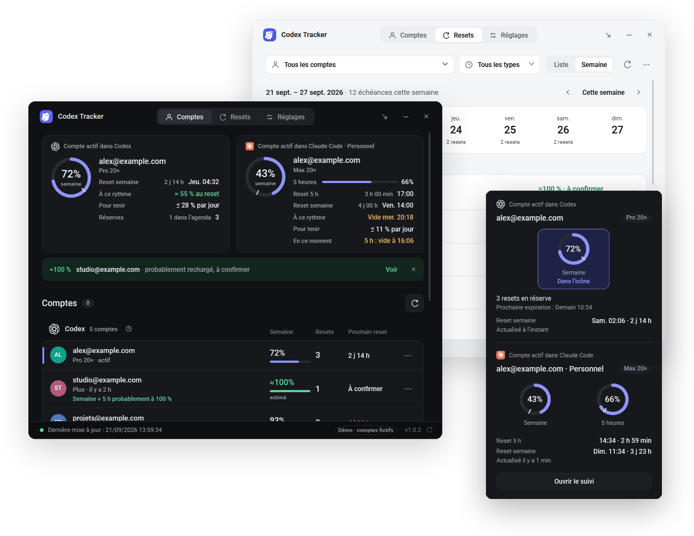

<picture><source media="(prefers-color-scheme: dark)" srcset="docs/brand/owl-dark.svg"></picture>

<h1 align="center">Codex Tracker</h1>

<strong>Always know how much Codex and Claude Code usage you have left.</strong> Your 5-hour and weekly limits, the next reset time and a reminder at the right moment, right in the Windows taskbar.

<a href="https://github.com/Aleqsd/codex-tracker/releases/download/v1.0.3/CodexTracker-1.0.3-Setup.exe"><strong>⬇ Download for Windows</strong></a> · <a href="https://codex-tracker.zqsdev.com">Website</a> · <a href="README.md">Français</a>

Free · Windows 11 x64 · No account, no server · 6 languages · Version 1.0.3

## Why

<picture><source media="(prefers-color-scheme: dark)" srcset="docs/brand/watching-dark.png"></picture>

OpenAI Codex and Claude Code limit your usage twice: over **5 hours** and over **the week**. Once a limit runs out you wait for it to reset, and nothing tells you clearly where you stand, especially across several accounts.

Codex Tracker answers three questions with nothing to configure:

- **How much is left?** The remaining percentage is drawn in the taskbar icon. Hover it for details.
- **When does it reset?** The exact reset time of each limit, for every account, as a list or a week view.
- **Which account should I use?** All your Codex and Claude Code accounts side by side, personal and work.

## Features

- Codex and Claude Code **usage limits** (5-hour and weekly) for every account, with the age of each reading.
- **Reset calendar** and **banked Codex reset credits** with their expiry; a notification when a new credit arrives and advice to use one before it is wasted.
- **Google Calendar sync** (credits added automatically, removed once used) and **Gmail alerts** the day before a credit expires.
- **On-screen pill** above the clock only when an account in use is nearly empty or a reset credit expires within 24 h, visible even in Do Not Disturb; hide it until the next alert.
- **Reminders** before a reset, below 20/10/5 %, before running out; Windows notifications, a free copy on your phone with ntfy (even in Do Not Disturb), or SMS, call and email with your own Twilio or SendGrid account.
- **Local MCP server** (off by default) so coding agents can read quotas and change reminders, channels, Google Calendar and most settings, plus the same commands on the command line (`CodexTracker.exe --cli help`).
- Light or dark theme, English, French, Spanish, German, Portuguese or Japanese, starts with Windows, self-updating.

## Install

<picture><source media="(prefers-color-scheme: dark)" srcset="docs/brand/terminal-dark.png"></picture>

1. **Download and run** the installer above. No admin rights.
2. **Use Codex or Claude Code as usual.** The signed-in account appears by itself; other accounts are added when you open them.
3. **Keep the icon visible** by dragging it out of the taskbar’s ^ overflow.

Or in one line in PowerShell: `irm https://codex-tracker.zqsdev.com/install.ps1 | iex` (SHA-256 checked), or ask Codex: https://codex-tracker.zqsdev.com/install/

A portable ZIP is on the [releases page](https://github.com/Aleqsd/codex-tracker/releases). The executables are not code-signed: SmartScreen may warn on first launch. For Claude Code in a terminal, copy the setting offered in **Settings → General → Claude Code** ([sources and limits](docs/CLAUDE-CODE.md)).

## Privacy

<picture><source media="(prefers-color-scheme: dark)" srcset="docs/brand/window-dark.png"></picture>

No sign-up, no server: everything stays on your PC. The tracker reads the quotas Codex and Claude already know, never your conversations or passwords, and never switches accounts. See the [privacy policy](https://codex-tracker.zqsdev.com/privacy/).

## More

<picture><source media="(prefers-color-scheme: dark)" srcset="docs/brand/reading-dark.png"></picture>

[User guide (French)](docs/UTILISATION.md) · [MCP server](docs/MCP.md) · [Report an issue](https://github.com/Aleqsd/codex-tracker/issues) · Development: .NET 10 / WPF, see [AGENTS.md](AGENTS.md); logo and owls in [assets/brand](assets/brand/README.md).

<picture><source media="(prefers-color-scheme: dark)" srcset="docs/brand/sleeping-dark.png"></picture>

---

Independent project, not affiliated with OpenAI or Anthropic. Codex and Claude are trademarks of their respective owners. [MIT](LICENSE) license.
